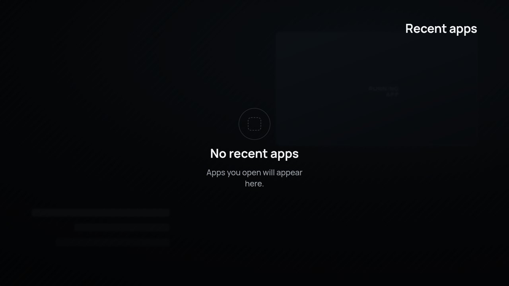

# Recent Apps TV

A fast, lightweight **Recent Apps switcher for Android TV and Google TV** — for the many TV
devices that ship with **no system "recent apps" screen**. It opens as a translucent layer
**over whatever is playing**, and lets you switch apps, remove one, or clear them all —
with the **remote's arrow keys only**.

The task list is read through **[Shizuku](https://shizuku.rikka.app/)** (no root needed).


<table>
<tr>
<td><br><sub><b>Kill all</b> — clears every recent app</sub></td>
<td><br><sub><b>Down</b> — the card steps down: press again to remove</sub></td>
</tr>
<tr>
<td><br><sub><b>Settings</b> — size, shape, colours, dim, exceptions</sub></td>
<td><br><sub><b>Exceptions</b> — hide apps from the list</sub></td>
</tr>
<tr>
<td><br><sub><b>Empty</b> — nothing to show</sub></td>
<td><br><sub><b>Shizuku</b> — shown until the service runs and access is granted</sub></td>
</tr>
</table>

<sub>Screens from the design. On the TV your real app icons appear and the playing app shows through behind.</sub>

## Remote controls

| Key | In the list |
|---|---|
| **← / →** | move between apps (→ goes toward newer apps and **Kill all**) |
| **OK** | switch to that app · on **Kill all**: clear everything |
| **Hold OK** | menu: *Add to exceptions* · *Kill app* · *App info* |
| **↓** then **↓** | remove that app (first press lifts the card down with a hint, second press sends it off) |
| **↑** | cancel a pending remove · otherwise jump to the ⚙ settings button |
| **Back** | close (the app underneath carries on) |
| **Menu** | settings |

In Settings: **↑ / ↓** choose a row, **← / → / OK** change it. The screen reads right-to-left as in the design.

## What's new in 1.1

- **The new design, fully applied** — the right-to-left layout, the green focus ring with its glow, the name under the
  focused app, the tinted Kill-all tile, and the Settings / Exceptions / Shizuku screens.
- **Smooth animations everywhere**: the screen fades in and the row rises into place, focus glides, cards close the gap
  when one is removed, the removed card falls away with a light trail, Kill all sends the cards up one after another,
  and Back fades out instead of cutting.
- **Opens faster.** After the first time it no longer starts from scratch (it steps aside instead of closing), so the
  backdrop starts fading in at once and the apps are ready **0.05–0.09 s** later. Measured from the launch request,
  reopening shows the apps in **0.28–0.36 s** instead of 0.38–0.45 s. A cold start (after Android has cleared the app
  from memory) stays about the same, ~0.8 s.
- **Smoother**: on the same D-pad test, slow frames dropped from 53–60 % to about 37 %, the median frame from 17–18 ms to
  14 ms, and the GPU time per frame from 14 ms to 11 ms.
- **Costs nothing while closed** — no service, no timers, no background work: 10 ms of CPU in 2 minutes,
  zero wake-ups, zero frames drawn, and less memory held (40 MB instead of 64 MB).
- **Fixes**: text was drawn in the thinnest weight of the font (now the design's weights); OK sometimes did nothing
  right after using the hold-OK menu; pressing OK while a removed card was still leaving switched to that app;
  volume keys now work while the list is open; the app is 1.2 MB instead of 6.1 MB.

Measured on a Samsung Galaxy A50 (Android 11), same test for both versions — see [docs/TESTING.md](docs/TESTING.md).

## Install

1. Install **Shizuku** on the TV and start it (wireless debugging or adb). See the Shizuku guide.
2. Install **Recent Apps TV** (download the APK from [Releases](../../releases)).
3. Open it once and choose **Open Shizuku & grant** → *Allow*.
4. Map a remote button to it (with a button-remapper app), using:

```
com.websnake.recentstv/.RecentsActivity        (or the action com.websnake.recentstv.OPEN_RECENTS)
```

It also appears as a normal app in the launcher, and publishes a launcher shortcut. There is deliberately no
"how to open" option inside the app. Settings: the ⚙ button, the **Menu** key, or `com.websnake.recentstv/.SettingsActivity`.

Upgrading from 1.0 keeps your settings. Reinstalling may ask for the Shizuku permission again.

## Requirements

- Android TV / Google TV, Android 7.0+ (minSdk 24)
- Shizuku running, with access granted to this app

## How it works

All privileged work sits in `RecentTasksRepository`, through the Shizuku shell identity
(`MANAGE_ACTIVITY_TASKS`, `REMOVE_TASKS`, `FORCE_STOP_PACKAGES`):

| Action | How |
|---|---|
| read | the root-task list over the binder (`getAllRootTaskInfos`, or `getAllStackInfos` on Android 10–11) — the same data `am stack list` prints, without starting a process; falls back to `am stack list`, then `dumpsys activity recents` |
| switch | `IActivityTaskManager.moveTaskToFront`, else the app's launch intent |
| remove | force-stop (optional), then `removeTask` for **every** task of that app |
| kill all | the same for every app shown |

Everything that decides what you see — the key handling, the task filtering, the settings rules, the row geometry —
is plain Kotlin in `logic/`, with no Android types, so it is tested on the computer (below).

```
com.websnake.recentstv
├─ logic/        Overlay (keys → state + effects), TaskList, Settings, SettingsNav, Geometry   ← fully tested
├─ data/         RecentTasksRepository (Shizuku), PackageRepository (icons + labels, cached), SettingsStore
├─ ui/           theme, overlay row, context menu, settings, empty and Shizuku screens
├─ RecentsActivity   the overlay window: runs the effects, never finishes (steps aside → instant reopen)
└─ SettingsActivity
```

Why it is fast: positions are computed instead of measured, and every moving value is read only while drawing, so a key
press moves one layer instead of rebuilding the row. Icons are prepared off the main thread and kept on disk, labels too.
Settings live in plain SharedPreferences (DataStore cost 150–200 ms on every cold open). R8 shrinks and optimises the app.

## Tests — the flow map

The project keeps a **flow map** (`docs/FLOW-MAP.md`): every path through `logic/` has a row and one test, and a gate
fails the build on any line or branch that no test runs. 96 tests, 100 % of lines and branches; the critical conditions
are mutation-tested (each one is removed in a copy and a test must fail: 19 of 19 caught).

```bash
./gradlew :app:testDebugUnitTest                 # the tests
python3 tools/flow/flowmap.py check --twice     # the full gate (runs the tests with coverage)
```

## Build

```bash
./gradlew :app:assembleRelease     # JDK 17+, Android SDK 35
# → app/build/outputs/apk/release/app-release.apk
```

## Credits

Design: Claude Design. [Shizuku](https://github.com/RikkaApps/Shizuku) by RikkaApps,
[HiddenApiBypass](https://github.com/LSPosed/AndroidHiddenApiBypass) by LSPosed. Font: Manrope (OFL).
