# Recent Apps TV

A fast, lightweight **Recent Apps switcher for Android TV and Google TV** — for the many TV
devices that ship with **no system "recent apps" screen**. It opens as a translucent layer
**over whatever is playing**, and lets you switch apps, remove one, or clear them all —
with the **remote's arrow keys only**.

The task list is read through **[Shizuku](https://shizuku.rikka.app/)** (no root needed), with usage access as a
backup when Shizuku isn't running.

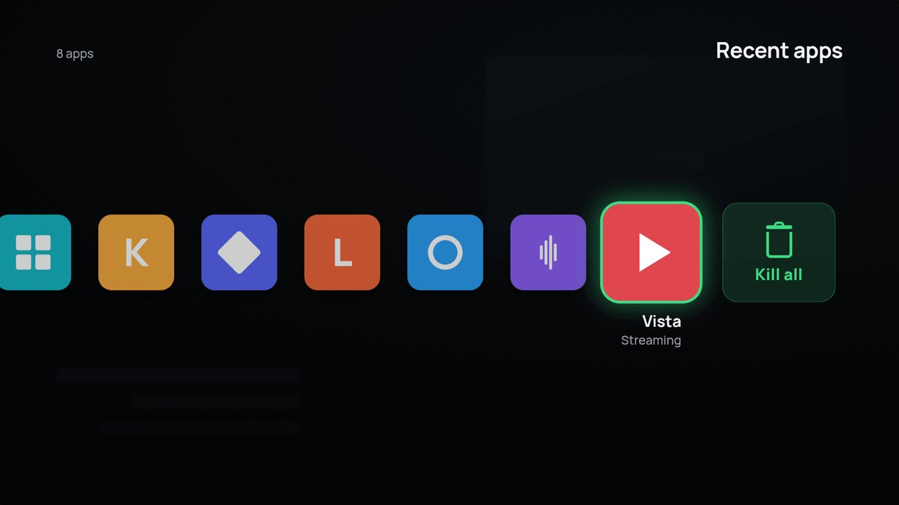

<table>
<tr>
<td>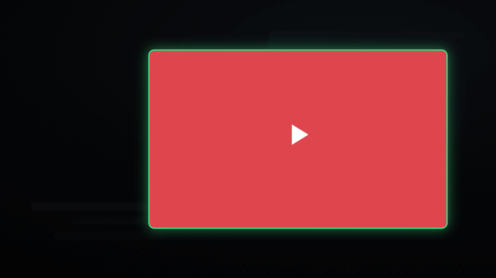<br><sub><b>OK</b> — the tile grows to full screen in the app's colour, then the app opens</sub></td>
<td>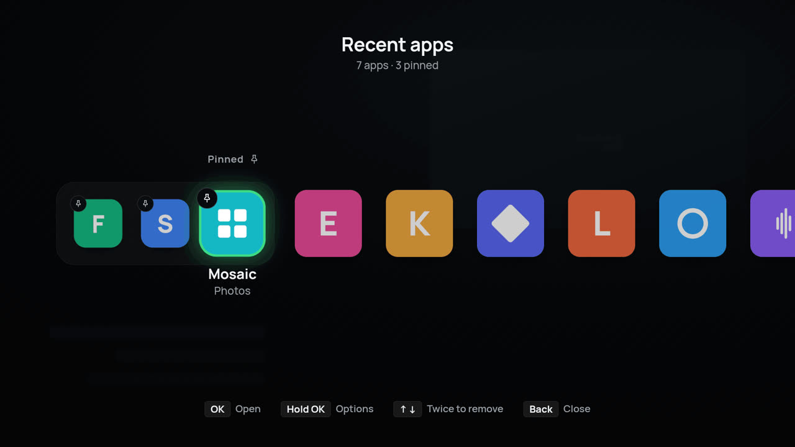<br><sub><b>Pinned apps</b> — always in the row, running or not</sub></td>
</tr>
<tr>
<td>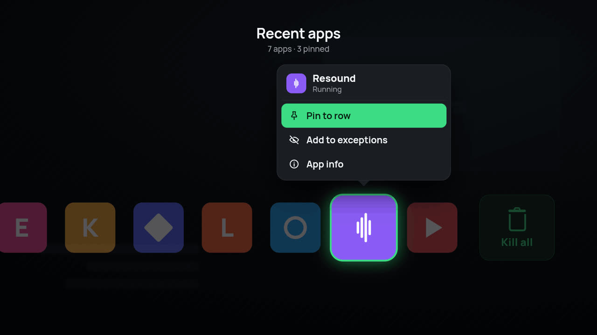<br><sub><b>↑ or Hold OK</b> — pin, hide, app info, close (design; on the device the balloon reads from the card up)</sub></td>
<td>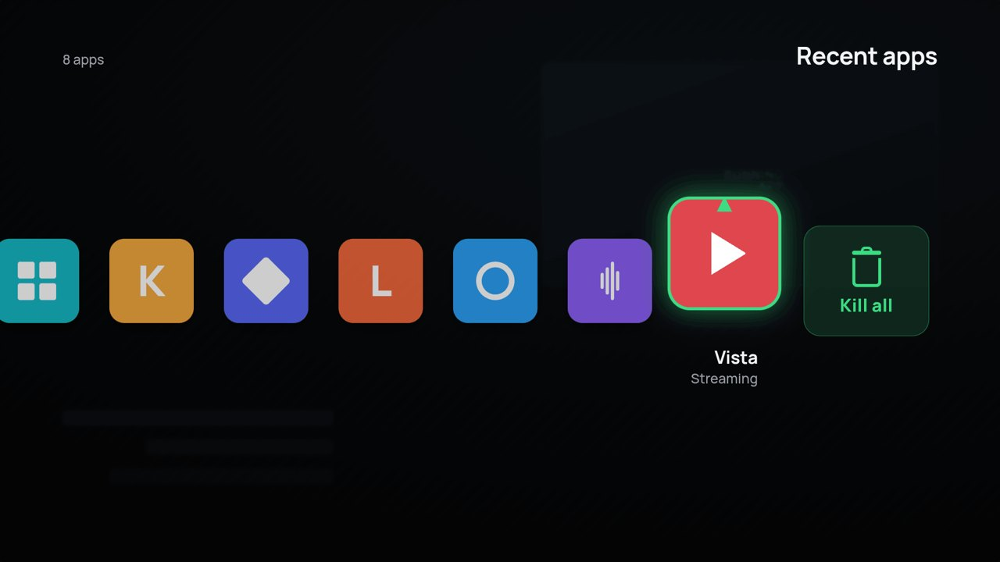<br><sub><b>↓ twice</b> — the card steps aside, the second press sends it off</sub></td>
</tr>
<tr>
<td>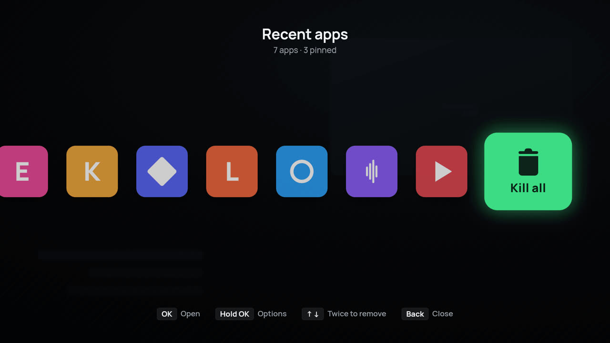<br><sub><b>Kill all</b> — clears running apps; pins stay</sub></td>
<td>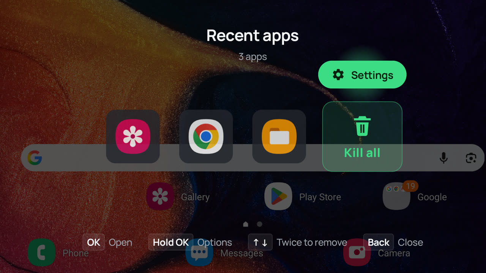<br><sub><b>↑ on Kill all</b> — the ⚙ Settings button above it; the focused tile is always centred (on a device)</sub></td>
</tr>
<tr>
<td>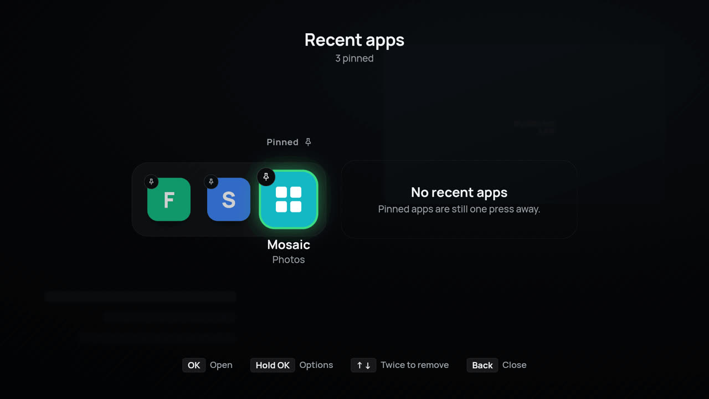<br><sub><b>Nothing running</b> — your pins are still one press away</sub></td>
<td>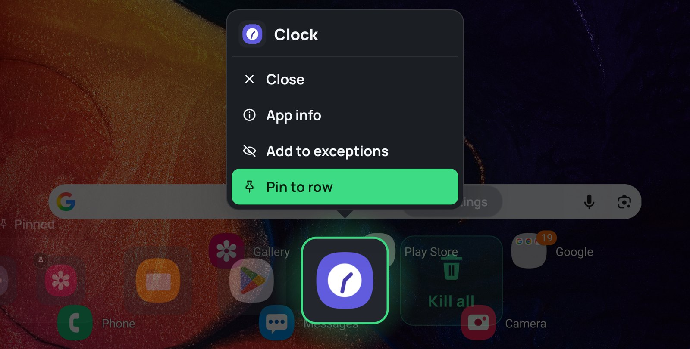<br><sub><b>↑ or Hold OK</b> on a device — from the card up: Pin to row (focused), Add to exceptions, App info, Close</sub></td>
</tr>
<tr>
<td>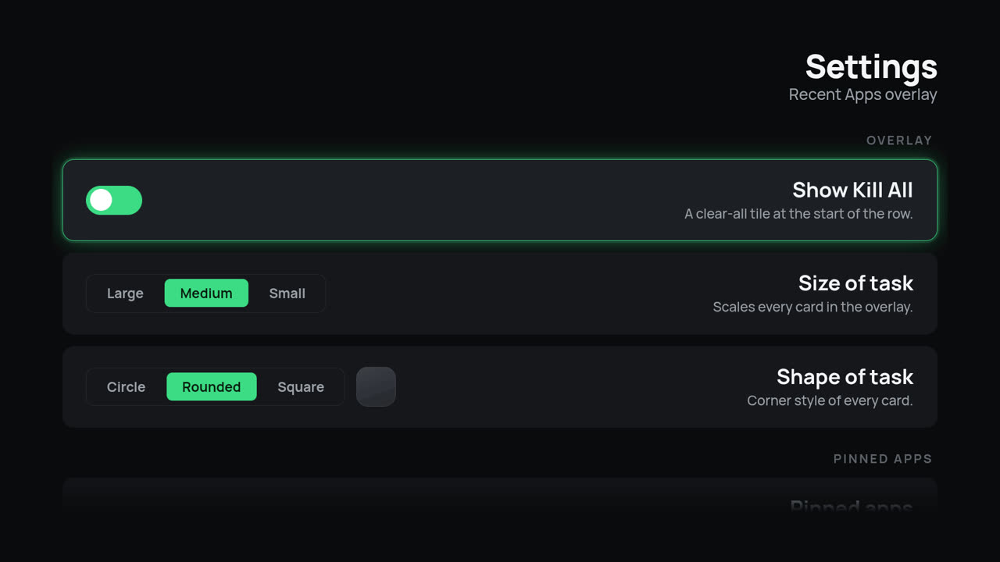<br><sub><b>Settings</b> — overlay, pinned apps, background, hidden apps</sub></td>
<td>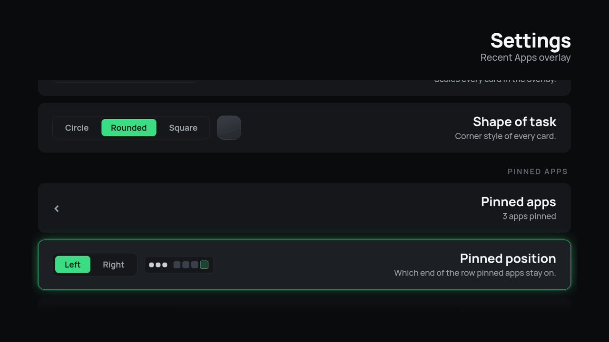<br><sub><b>Pins</b> — which end of the row, and how big</sub></td>
</tr>
<tr>
<td>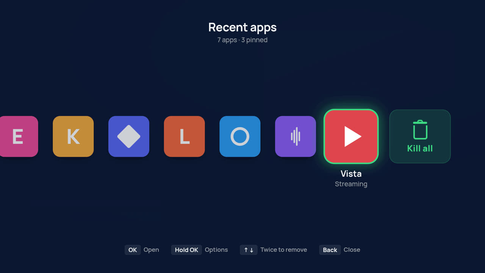<br><sub><b>Background</b> — dim, blur, a colour…</sub></td>
<td>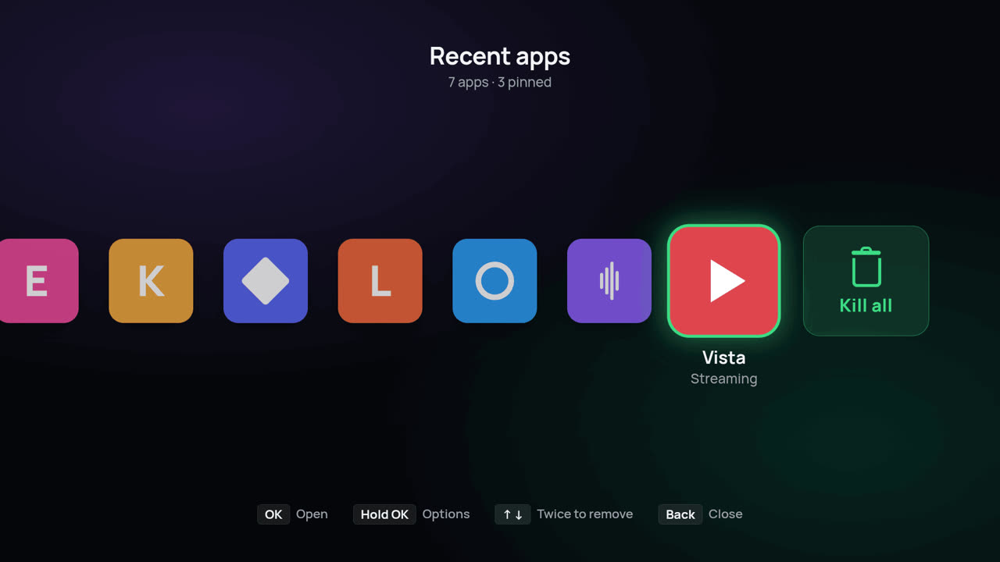<br><sub>…or your own picture</sub></td>
</tr>
<tr>
<td>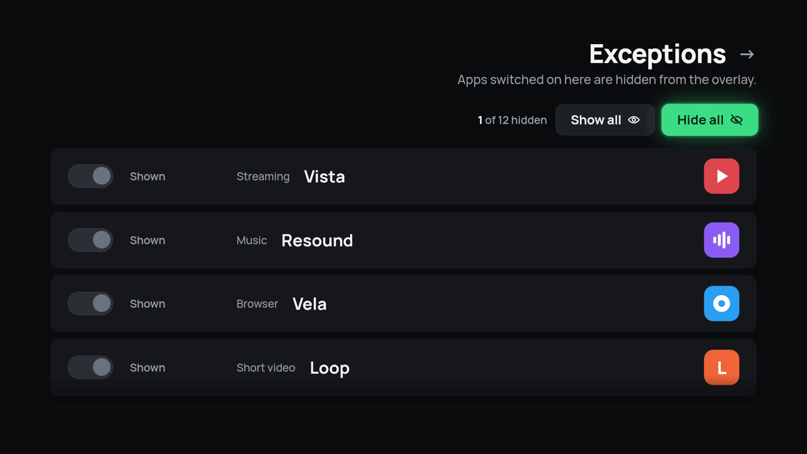<br><sub><b>Exceptions</b> — hide apps; Hide all / Show all</sub></td>
<td>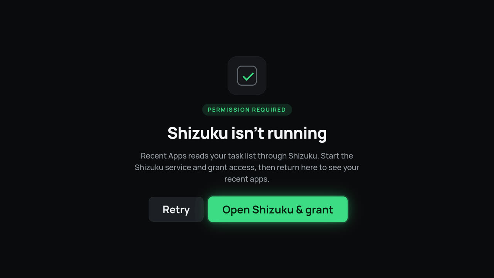<br><sub><b>Shizuku</b> — shown until the service runs and access is granted</sub></td>
</tr>
</table>

<sub>Screens from the design. On the TV your real app icons appear and the playing app shows through behind.</sub>

## Remote controls

| Key | In the list |
|---|---|
| **← / →** | move between apps (→ goes toward newer apps and **Kill all**) — the focused app always sits in the middle of the screen |
| **↑** on **Kill all** | the **⚙ Settings** button above it (**↓** back to Kill all, **←** on to the apps) |
| **OK** | open that app (on the app you are already in: just close the list) · on **Kill all**: clear running apps (pins stay) · on **⚙ Settings**: open Settings |
| **↑** or **Hold OK** (about half a second) | the app's balloon menu, read from the card up: *Pin to row / Unpin* (focused first) · *Add to exceptions* · *App info* · *Close* (✕) — it stays open after you let go; **↑** climbs, **↓** steps back and on *Pin* closes it, **OK** runs, **Back** closes |
| **↓ ↓** | remove that app (first press lowers the card with a hint — **↑** puts it back — second press sends it off); pinned apps can't be removed this way; *Close* in the menu does the same, also for a running pinned app (it stays pinned) |
| **Back** | close the menu, or close the list (the app underneath carries on) |
| **the button that opened it** | press it again to close the list (a toggle) — no key remapping inside the app |
| **Menu** | settings (remotes that have the key) |

When *Kill all* isn't shown (nothing running, or turned off in Settings), the ⚙ button takes its place at the right end
of the row: **→** to it, then **OK**.

In Settings: **↑ / ↓** choose a row, **← / → / OK** change it. The screen reads right-to-left as in the design; *Pinned
position* and the colour swatches read left-to-right (→ means Right). On *Pinned apps* and *Exceptions*, **↑** from the
first row reaches the *Unpin all* / *Hide all* / *Show all* buttons. On *Background image*, **↑** from the pictures
reaches the picker apps (Gallery, Files…).

## What's new in 1.10

- **OK on the app you are already in just closes the list** — no zoom, no colour, no relaunch, you stay where you were.
  The app under the list is the first task in the system's store (or, with Shizuku off, the last app used); every other
  app still opens with the animation.
- 1.10.1: the balloon's header shows just the app name (no "Running" / "Not running"; "Pinned" for a pinned app).

## What's new in 1.9

- **The balloon is a sub-menu of the card**, read from the bottom up: *Close* · *App info* · *Add to exceptions* ·
  *Pin to row*. *Pin to row* sits nearest the card and has the focus when it opens; **↑** climbs, **↓** on *Pin to row*
  closes the balloon and the card is as before.
- **↑ on a lowered card** (after the first ↓) puts it back — nothing is removed.
- *Close* has an **✕** icon (it was a bin).

## What's new in 1.8

- **One button opens and closes it.** Press the button you mapped (tvQuickActions, Button Mapper…) to open the list and
  press it again to close it. The app remaps no keys: a second launch while the list is on screen simply closes it — from
  a mapped app launch, the launcher, the `OPEN_RECENTS` action or a shortcut.
- **"Open Recent Apps" in the Shortcuts list** of button mappers (the standard shortcut picker, `CREATE_SHORTCUT`) — in
  tvQuickActions: *Shortcuts → Recent Apps → Open Recent Apps*.
- **↑ on an app opens its menu** (as holding OK does); **↓ ↓** still removes it.
- **The menu is about that app only:** *Pin to row* · *Add to exceptions* · *App info* · **Close** (removes it — force-stop and
  its tasks, as ↓ ↓). Settings has its own ⚙ button above Kill all.
- **The focused app is always in the middle of the screen**, at both ends of the row too.
- **Smoother motion:** moving ←/→ and the card moving down / flying off run on springs that keep their speed when you
  press again mid-move, so quick presses glide. Measured on the A50: no extra cost per frame (slightly fewer slow frames).

## What's new in 1.7

Tested end to end on the A50 with Shizuku in shell mode (the TV's identity), from a fresh install.

- **Every recent app, not just the last few hours.** The TV hides any app unused for 6 hours from the system's "visible"
  recents list (`config_activeTaskDurationHours=6`), so 1.6 showed 1–2 apps while the TV kept 47. The row now reads
  everything the system stores (`dumpsys activity recents`) — on the owner's TV that is 25 apps instead of 1 — and each
  one still **reopens where you left it**. Up to 20 apps are shown.
- **Usage access, read when the row opens** — no background service (the system already keeps about 10 days of usage
  events, and the TV's low-power standby would stop a background tracker anyway). It adds apps used in the last 3 days
  that no longer own a task; apps that can resume always get a place first. The app **grants itself** usage access
  through Shizuku the first time — the only question on first launch is Shizuku's *Allow*.
- **Removed means removed.** ↑↑ (or Kill all) force-stops the app, removes all its tasks, and remembers it: it stays out
  of the row — even out of the usage history — until you open it again.
- **Works after a TV reboot, before Shizuku is back.** The row is built from the last list plus usage access (a yellow
  line says so); apps open from their start screen, and anything you remove is killed for real as soon as Shizuku returns.
- The Shizuku screen says *Allow Recent Apps in Shizuku* when Shizuku runs but the grant is missing; the ⚙ button steps
  aside while the "press again to remove" hint is up; Kill all never touches a launcher task.

## What's new in 1.6

Checked against how Android's own recents screen does it (SystemUI / Launcher3 / WM Shell in AOSP) and tested on the
A50 with Shizuku in shell mode, the way it runs on the TV:

- **The list is the system's own recents list** (`getRecentTasks`, most recent first), not the windows that happen to be
  open. On the TV both hold the same apps but in a different order; on a phone the open windows were 3 of 21.
- **Opening an app works the system way on the TV.** With Shizuku as shell, `moveTaskToFront` was refused
  ("package=null does not belong to uid=2000"), so 1.0–1.5 always fell back to relaunching the app there. Now it uses
  `startActivityFromRecents`, like the recents screen — it also brings back an app the system had closed.
- **The system Settings app shows up.** It registers a fallback home screen, so it was taken for a launcher and hidden.
- Force-stop now targets the current user instead of user 0.

## What's new in 1.5

- **⚙ Settings now sits above Kill all.** Go to *Kill all* (→), press **↑** to reach *Settings*, **OK** opens it;
  **↓** goes back. With no *Kill all* on screen the button stays at the right end of the row, so Settings is always
  reachable. (1.4 put it in the row after Kill all.)

## What's new in 1.4

- **Hold OK works on a real remote.** In 1.3, holding OK on the TV pinned the app at once and no menu was seen: the
  remote repeats a held OK about every 50 ms, and a repeat ran the menu's first row (*Pin*) the moment it opened. The
  hold is now timed (550 ms, as in the design), key repeats are ignored, and the balloon stays open until you choose.
- **A way into Settings on every remote**: 1.2 and 1.3 put Settings only in the hold menu (and the Menu key, which the
  Google TV remote doesn't have). 1.4 added a ⚙ tile to the row; 1.5 moved it above Kill all. The hold menu's
  *Settings* row works too.

## What's new in 1.3

- **Choosing a background picture now works on a TV.** Android TV usually hands the system "pick a file" request to a
  stub that only says "no app", so 1.2's picker could open nothing there. Settings → Background → *Background image*
  now opens a picture screen like Projectivy Launcher's: your **Gallery, file managers and other picker apps** in a
  row on top (each asked directly, the stub skipped), and the **pictures on the device** in a grid below — all with
  the remote.
- **Shown centre-cropped**, filling the screen.
- **Any size, same speed:** the picture is prepared once when you pick it — read at a reduced size, cropped to the
  screen's shape and scaled to the screen (at most 1920×1080) — so a 50-megapixel photo costs the overlay the same as
  a small one. It is decoded straight into graphics memory while the list is open and released when it closes. On
  the A50 a 6000×3375 photo opened with the list in 126 ms.

## What's new in 1.2

- **Opening an app is animated.** Press OK: the tile presses in, grows to full screen in the app's own colour with its
  name, and the app opens out of it. In 1.1 the app was opened at the same moment, which hid the short zoom and looked
  like a freeze.
- **No more flicker when moving left / right.** The app name under the focused card used to vanish and reappear on every
  move; now each card carries its own name and the two names cross-fade, and the row moves in whole pixels so text
  never shimmers.
- **Pinned apps** — pin any app (hold OK → *Pin to row*, or Settings → *Pinned apps*). Pins always show, running or not,
  in their own group with a pin badge and a dot when running; at the far end (default) or next to Kill all; small or
  task-sized. Kill all leaves them. With nothing running they still show, beside a "No recent apps" note.
- **Background** — *Dim* (with its strength), *Blur* (Android 12+ devices that support it), a *Colour* (5 swatches) or
  your own *Image* (picked with the remote from device storage).
- **New hold-OK menu**: a balloon above the app — Pin / Unpin, Add to exceptions, App info, Settings — with the row
  sliding down beneath it and a confirmation toast.
- **Remove with ↑ or ↓** — twice in the same direction.
- **Exceptions**: *Hide all* / *Show all*, and a count. **Pinned apps list** with *Unpin all*.
- Footer hints, centred header with "7 apps · 3 pinned".
- **Fixes**: an OK pressed in the hold menu could also open the app under it when released (also in 1.1, after *Add to
  exceptions*); a release during an animation could leave the next OK ignored.
- Same speed and same zero cost while closed: reopening shows the apps in 0.30–0.37 s, a cold start in 0.52–0.61 s
  (1.1: ~0.8 s); hidden for a minute: 0 wake-ups, 40 MB.

Measured on a Samsung Galaxy A50 (Android 11) — see [docs/TESTING.md](docs/TESTING.md).

## Install and update with ObtainX or Obtainium

Let [ObtainX](https://github.com/bikram-agarwal/ObtainX) or [Obtainium](https://github.com/ImranR98/Obtainium) install
the app and keep it updated from this repo's releases:

[](https://apps.obtainium.imranr.dev/redirect?r=obtainium%3A%2F%2Fapp%2F%257B%2522id%2522%253A%2522com.websnake.recentstv%2522%252C%2522url%2522%253A%2522https%253A%252F%252Fgithub.com%252FQutaiba-Khader%252FRecentAppsTV%2522%252C%2522author%2522%253A%2522Qutaiba-Khader%2522%252C%2522name%2522%253A%2522Recent%2520Apps%2520TV%2522%252C%2522preferredApkIndex%2522%253A0%252C%2522additionalSettings%2522%253A%2522%257B%255C%2522includePrereleases%255C%2522%253Afalse%252C%255C%2522fallbackToOlderReleases%255C%2522%253Atrue%252C%255C%2522filterReleaseTitlesByRegEx%255C%2522%253A%255C%2522%255C%2522%252C%255C%2522filterReleaseNotesByRegEx%255C%2522%253A%255C%2522%255C%2522%252C%255C%2522verifyLatestTag%255C%2522%253Afalse%252C%255C%2522dontSortReleasesList%255C%2522%253Afalse%252C%255C%2522useLatestAssetDateAsReleaseDate%255C%2522%253Afalse%252C%255C%2522trackOnly%255C%2522%253Afalse%252C%255C%2522versionExtractionRegEx%255C%2522%253A%255C%2522%255C%2522%252C%255C%2522matchGroupToUse%255C%2522%253A%255C%2522%255C%2522%252C%255C%2522versionDetection%255C%2522%253Atrue%252C%255C%2522releaseDateAsVersion%255C%2522%253Afalse%252C%255C%2522useVersionCodeAsOSVersion%255C%2522%253Afalse%252C%255C%2522apkFilterRegEx%255C%2522%253A%255C%2522%255C%2522%252C%255C%2522invertAPKFilter%255C%2522%253Afalse%252C%255C%2522autoApkFilterByArch%255C%2522%253Atrue%252C%255C%2522appName%255C%2522%253A%255C%2522%255C%2522%252C%255C%2522shizukuPretendToBeGooglePlay%255C%2522%253Afalse%252C%255C%2522allowInsecure%255C%2522%253Afalse%252C%255C%2522exemptFromBackgroundUpdates%255C%2522%253Afalse%252C%255C%2522skipUpdateNotifications%255C%2522%253Afalse%252C%255C%2522about%255C%2522%253A%255C%2522%255C%2522%257D%2522%252C%2522overrideSource%2522%253Anull%257D)
&nbsp;
[](https://apps.obtainium.imranr.dev/redirect?r=obtainium%3A%2F%2Fapp%2F%257B%2522id%2522%253A%2522com.websnake.recentstv%2522%252C%2522url%2522%253A%2522https%253A%252F%252Fgithub.com%252FQutaiba-Khader%252FRecentAppsTV%2522%252C%2522author%2522%253A%2522Qutaiba-Khader%2522%252C%2522name%2522%253A%2522Recent%2520Apps%2520TV%2522%252C%2522preferredApkIndex%2522%253A0%252C%2522additionalSettings%2522%253A%2522%257B%255C%2522includePrereleases%255C%2522%253Afalse%252C%255C%2522fallbackToOlderReleases%255C%2522%253Atrue%252C%255C%2522filterReleaseTitlesByRegEx%255C%2522%253A%255C%2522%255C%2522%252C%255C%2522filterReleaseNotesByRegEx%255C%2522%253A%255C%2522%255C%2522%252C%255C%2522verifyLatestTag%255C%2522%253Afalse%252C%255C%2522dontSortReleasesList%255C%2522%253Afalse%252C%255C%2522useLatestAssetDateAsReleaseDate%255C%2522%253Afalse%252C%255C%2522trackOnly%255C%2522%253Afalse%252C%255C%2522versionExtractionRegEx%255C%2522%253A%255C%2522%255C%2522%252C%255C%2522matchGroupToUse%255C%2522%253A%255C%2522%255C%2522%252C%255C%2522versionDetection%255C%2522%253Atrue%252C%255C%2522releaseDateAsVersion%255C%2522%253Afalse%252C%255C%2522useVersionCodeAsOSVersion%255C%2522%253Afalse%252C%255C%2522apkFilterRegEx%255C%2522%253A%255C%2522%255C%2522%252C%255C%2522invertAPKFilter%255C%2522%253Afalse%252C%255C%2522autoApkFilterByArch%255C%2522%253Atrue%252C%255C%2522appName%255C%2522%253A%255C%2522%255C%2522%252C%255C%2522shizukuPretendToBeGooglePlay%255C%2522%253Afalse%252C%255C%2522allowInsecure%255C%2522%253Afalse%252C%255C%2522exemptFromBackgroundUpdates%255C%2522%253Afalse%252C%255C%2522skipUpdateNotifications%255C%2522%253Afalse%252C%255C%2522about%255C%2522%253A%255C%2522%255C%2522%257D%2522%252C%2522overrideSource%2522%253Anull%257D)

- **On a phone or a device with a browser:** tap a badge. Both apps open the same kind of link, so if you have both,
  Android asks which one to use. The app is added with the right settings, ready to install.
- **On the TV** (usually no browser): in ObtainX or Obtainium choose **Add app** and enter
  `https://github.com/Qutaiba-Khader/RecentAppsTV`, then **Add** and **Install**.
- **Updates:** each new release here (a `v1.2`-style tag with the APK attached) shows up as an update in the app.
  The installed version (`1.3`) and the release tag (`v1.3`) are read as the same version, so no false updates.
- Already added before? The link only opens the existing entry. Remove it first to re-add it with these settings.

<details><summary>Raw link (for ObtainX → Import from URL list, or to share)</summary>

```
obtainium://app/%7B%22id%22%3A%22com.websnake.recentstv%22%2C%22url%22%3A%22https%3A%2F%2Fgithub.com%2FQutaiba-Khader%2FRecentAppsTV%22%2C%22author%22%3A%22Qutaiba-Khader%22%2C%22name%22%3A%22Recent%20Apps%20TV%22%2C%22preferredApkIndex%22%3A0%2C%22additionalSettings%22%3A%22%7B%5C%22includePrereleases%5C%22%3Afalse%2C%5C%22fallbackToOlderReleases%5C%22%3Atrue%2C%5C%22filterReleaseTitlesByRegEx%5C%22%3A%5C%22%5C%22%2C%5C%22filterReleaseNotesByRegEx%5C%22%3A%5C%22%5C%22%2C%5C%22verifyLatestTag%5C%22%3Afalse%2C%5C%22dontSortReleasesList%5C%22%3Afalse%2C%5C%22useLatestAssetDateAsReleaseDate%5C%22%3Afalse%2C%5C%22trackOnly%5C%22%3Afalse%2C%5C%22versionExtractionRegEx%5C%22%3A%5C%22%5C%22%2C%5C%22matchGroupToUse%5C%22%3A%5C%22%5C%22%2C%5C%22versionDetection%5C%22%3Atrue%2C%5C%22releaseDateAsVersion%5C%22%3Afalse%2C%5C%22useVersionCodeAsOSVersion%5C%22%3Afalse%2C%5C%22apkFilterRegEx%5C%22%3A%5C%22%5C%22%2C%5C%22invertAPKFilter%5C%22%3Afalse%2C%5C%22autoApkFilterByArch%5C%22%3Atrue%2C%5C%22appName%5C%22%3A%5C%22%5C%22%2C%5C%22shizukuPretendToBeGooglePlay%5C%22%3Afalse%2C%5C%22allowInsecure%5C%22%3Afalse%2C%5C%22exemptFromBackgroundUpdates%5C%22%3Afalse%2C%5C%22skipUpdateNotifications%5C%22%3Afalse%2C%5C%22about%5C%22%3A%5C%22%5C%22%7D%22%2C%22overrideSource%22%3Anull%7D
```

</details>

## Install

1. Install **Shizuku** on the TV and start it (wireless debugging or adb). See the Shizuku guide.
2. Install **Recent Apps TV**: with ObtainX / Obtainium (above), or the APK from [Releases](../../releases).
3. Open it once and choose **Open Shizuku & grant** → *Allow*. That is the only question; usage access is granted
   automatically through Shizuku.
4. Map a remote button to it (with a button-remapper app) — pick the shortcut **Open Recent Apps**, or launch the app / activity:

```
com.websnake.recentstv/.RecentsActivity        (or the action com.websnake.recentstv.OPEN_RECENTS)
```

Pressing the same button again closes the list. It also appears as a normal app in the launcher, and publishes a launcher shortcut. There is deliberately no
"how to open" option inside the app. Settings: **↑** on *Kill all* → ⚙ *Settings*, the **Menu** key, or `com.websnake.recentstv/.SettingsActivity`.

Upgrading from 1.0 keeps your settings. Reinstalling may ask for the Shizuku permission again.

## Requirements

- Android TV / Google TV, Android 7.0+ (minSdk 24)
- Shizuku running, with access granted to this app (without it, after a reboot, the row still works from the last list
  and usage access, but apps open fresh and removals wait for Shizuku)

## How it works

All privileged work sits in `RecentTasksRepository`, through the Shizuku shell identity
(`REAL_GET_TASKS`, `START_TASKS_FROM_RECENTS`, `MANAGE_ACTIVITY_TASKS`, `REMOVE_TASKS`, `FORCE_STOP_PACKAGES` — all held by shell):

| Action | How |
|---|---|
| read | everything the system stores: `dumpsys activity recents` (the store's order; home, excluded and unavailable tasks dropped), checked against `getRecentTasks` — the TV's visible list hides tasks unused for 6 h. Plus usage access (`UsageStatsManager.queryEvents`, only the events since the last open) for apps used in the last 3 days without a task, and a removal ledger so a removed app stays out until it is used again (`logic/Stored.kt`) |
| Shizuku off | the last row saved on disk + usage access; apps open by their launch intent; removals are queued and replayed (force-stop + `removeTask`) when Shizuku is back |
| switch | after the select zoom: `startActivityFromRecents(taskId)` (as the recents screen; `START_TASKS_FROM_RECENTS`), else `moveTaskToFront`, else the app's launch intent (a pinned app that isn't running) |
| remove | force-stop (optional), then `removeTask` for **every** task of that app |
| kill all | the same for every running app shown (pins included); the pins stay in the row |

Everything that decides what you see — the key handling, the task filtering, the settings rules, the row geometry —
is plain Kotlin in `logic/`, with no Android types, so it is tested on the computer (below).

```
com.websnake.recentstv
├─ logic/        Overlay (keys → state + effects), Stored (row sources), TaskList, Settings, SettingsNav, Geometry ← fully tested
├─ data/         RecentTasksRepository (Shizuku), RowStore (ledger, seed, usage), PackageRepository (icons, labels, colours, cached), SettingsStore,
│                ImageSources (picker apps + device pictures), BackdropImage (crop + scale once)
├─ ui/           theme, overlay row + pins, select zoom, hold menu, toast, settings + app lists, empty and Shizuku screens
├─ RecentsActivity   the overlay window: runs the effects, never finishes (steps aside → instant reopen)
└─ SettingsActivity
```

Why it is fast: positions are computed instead of measured, and every moving value is read only while drawing, so a key
press moves one layer instead of rebuilding the row. Icons are prepared off the main thread and kept on disk, labels too.
Settings live in plain SharedPreferences (DataStore cost 150–200 ms on every cold open). R8 shrinks and optimises the app.

## Tests — the flow map

The project keeps a **flow map** (`docs/FLOW-MAP.md`): every path through `logic/` has a row and one test, and a gate
fails the build on any line or branch that no test runs. 184 tests, 100 % of lines and branches; the critical conditions
are mutation-tested (each one is removed in a copy and a test must fail: 59 of 59 caught).

Remote input is tested on a real device as well, with `tools/perf/rkey` — a tiny virtual remote (uinput, root) that
holds keys the way a TV remote does, so Android sends its own key repeats. (`adb shell input keyevent --longpress` sends
a single repeat; that is how the 1.3 hold bug slipped through.)

```bash
./gradlew :app:testDebugUnitTest                 # the tests
python3 tools/flow/flowmap.py check --twice     # the full gate (runs the tests with coverage)
```

## Build

```bash
./gradlew :app:assembleRelease     # JDK 17+, Android SDK 35
# → app/build/outputs/apk/release/app-release.apk
```

## Credits

Design: Claude Design. [Shizuku](https://github.com/RikkaApps/Shizuku) by RikkaApps,
[HiddenApiBypass](https://github.com/LSPosed/AndroidHiddenApiBypass) by LSPosed. Font: Manrope (OFL).
